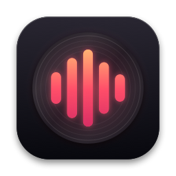
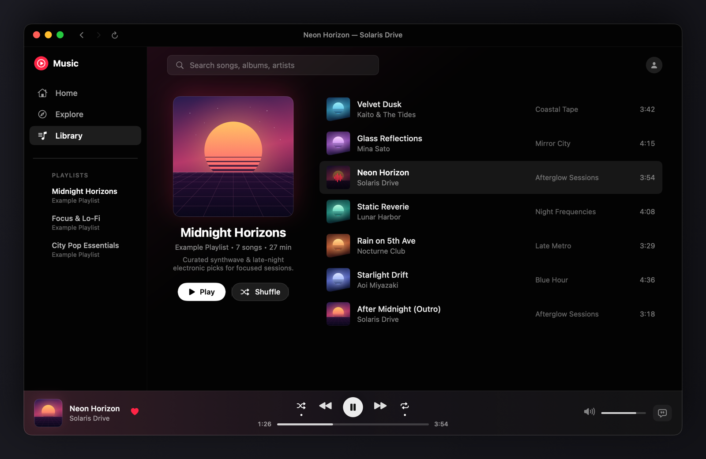
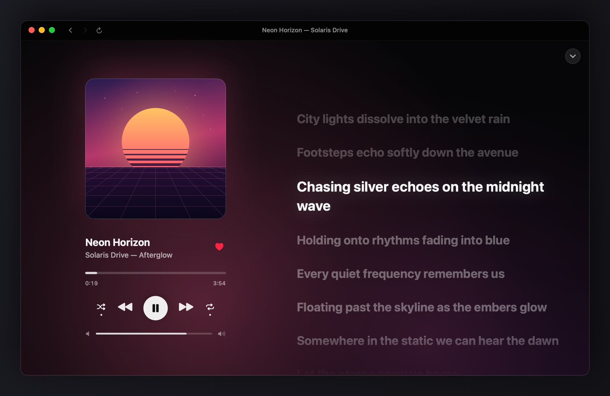

<div align="center">
  

  <h1>YTMusicDesk</h1>

  <p>
    An unofficial, lightweight native YouTube Music desktop app for macOS.
  </p>

  <p>
    <strong>macOS 14+</strong> &nbsp;·&nbsp;
    <strong>Swift 6 &amp; SwiftUI</strong> &nbsp;·&nbsp;
    <strong>Native WebKit</strong> &nbsp;·&nbsp;
    <strong>~3 MB</strong>
  </p>

  <p>
    <strong>English</strong> &nbsp;|&nbsp; <a href="README.zh-CN.md">简体中文</a>
  </p>
</div>

<br />

<p align="center">
  
</p>

<p align="center">
  
</p>

## Installation

### Download Release (Recommended)

Download the latest `.dmg` from **Releases** (Universal: Apple Silicon & Intel, requires **macOS 14.0+**), open it, and drag **YTMusicDesk.app** into **Applications**.

> Because this app uses ad-hoc signing without a paid Apple Developer ID, run once in Terminal if macOS blocks first launch:
>
> ```bash
> xattr -cr "/Applications/YTMusicDesk.app"
> ```

### Build from Source

Requires **macOS 14.0+** and **Swift 6+** (Xcode or Command Line Tools).

```bash
# Build and install to /Applications (available in Launchpad & Spotlight)
make install

# Build universal .dmg & .zip release packages into dist/
make dmg
```

## Keyboard Shortcuts

| Shortcut | Action |
| :--- | :--- |
| `⌘L` / `Esc` | Toggle Immersive Lyrics & Now Playing |
| `⌥⌘P` | Play / Pause |
| `⌥⌘←` / `⌥⌘→` | Previous / Next Track |
| `⌥⌘↑` / `⌥⌘↓` / `⌥⌘M` | Volume Up / Down / Mute |
| `⌥⌘L` | Like Current Track |
| `⌘[` / `⌘]` / `⌘R` | Back / Forward / Reload |
| `⌘W` / `⌘Q` | Hide Window (Keep Playing) / Quit |

---

<p align="center">
  <sub>YTMusicDesk is an independent, unofficial project licensed under <a href="LICENSE">MIT</a> and is not affiliated with or endorsed by Google LLC or YouTube. All trademarks belong to their respective owners. Synced lyrics are powered by <a href="https://lrclib.net">LRCLIB</a>.</sub>
</p>
