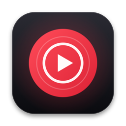
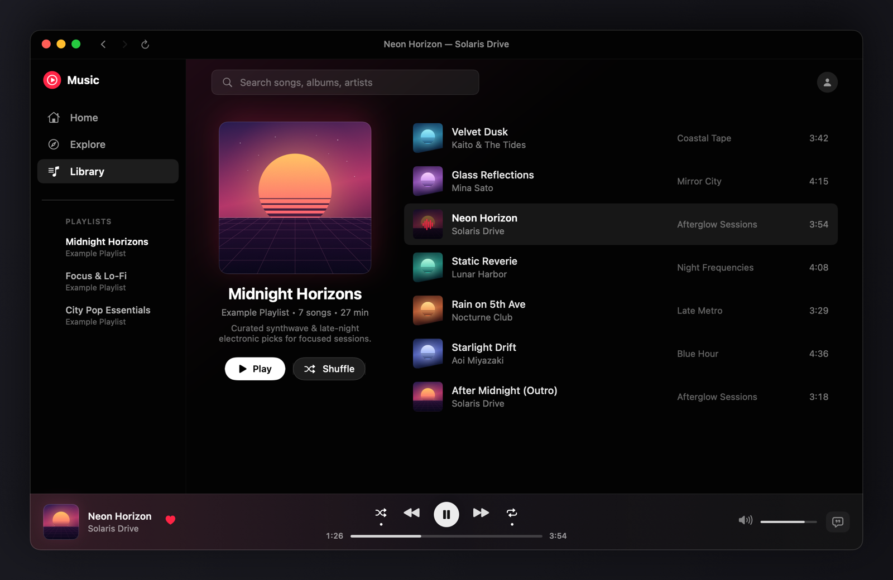
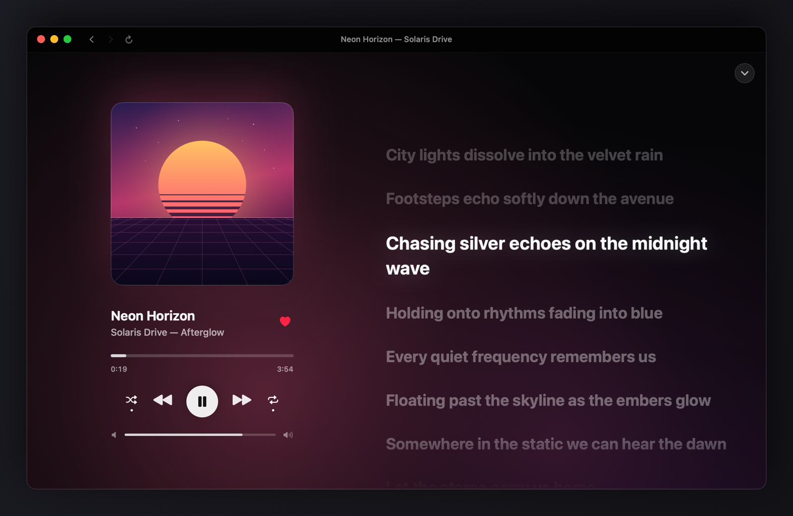

<div align="center">
  

  <h1>YouTube Music for macOS</h1>

  <p>
    一款轻量、原生的 unofficial YouTube Music macOS 桌面客户端。
  </p>

  <p>
    <strong>macOS 14+</strong> &nbsp;·&nbsp;
    <strong>Swift 6 &amp; SwiftUI</strong> &nbsp;·&nbsp;
    <strong>Native WebKit</strong> &nbsp;·&nbsp;
    <strong>~3 MB</strong>
  </p>

  <p>
    <a href="README.md">English</a> &nbsp;|&nbsp; <strong>简体中文</strong>
  </p>
</div>

<br />

<p align="center">
  
</p>

<p align="center">
  
</p>

## 快速开始

环境要求：**macOS 14.0+** 与 **Swift 6+**（安装 Xcode 或 Command Line Tools 均可）。

```bash
# 构建并安装到「应用程序」（自动出现在启动台与聚焦搜索）
make install

# 或仅构建并直接运行
make run
```

## 快捷键

| 快捷键 | 功能 |
| :--- | :--- |
| `⌘L` / `Esc` | 展开 / 收起沉浸式歌词播放器 |
| `⌥⌘P` | 播放 / 暂停 |
| `⌥⌘←` / `⌥⌘→` | 上一首 / 下一首 |
| `⌥⌘↑` / `⌥⌘↓` / `⌥⌘M` | 增大 / 减小音量 / 静音 |
| `⌥⌘L` | 喜欢当前曲目 |
| `⌘[` / `⌘]` / `⌘R` | 后退 / 前进 / 刷新 |
| `⌘W` / `⌘Q` | 隐藏窗口（后台继续播放） / 彻底退出 |

---

<p align="center">
  <sub>非官方桌面客户端，音乐内容与账号体系均直接由官方 YouTube Music 网页提供，时间轴歌词由 <a href="https://lrclib.net">LRCLIB</a> 提供支持。</sub>
</p>
